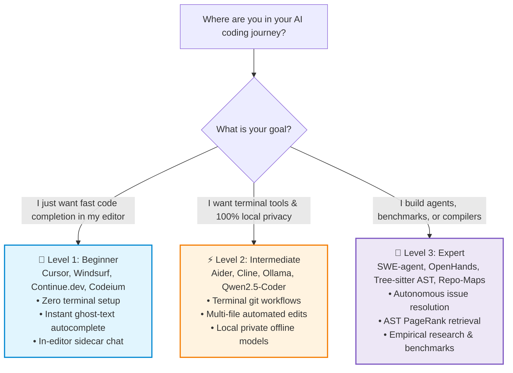
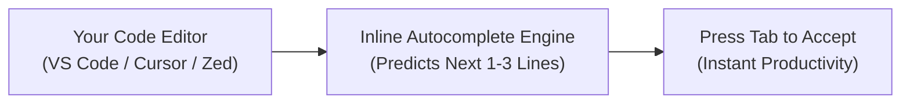
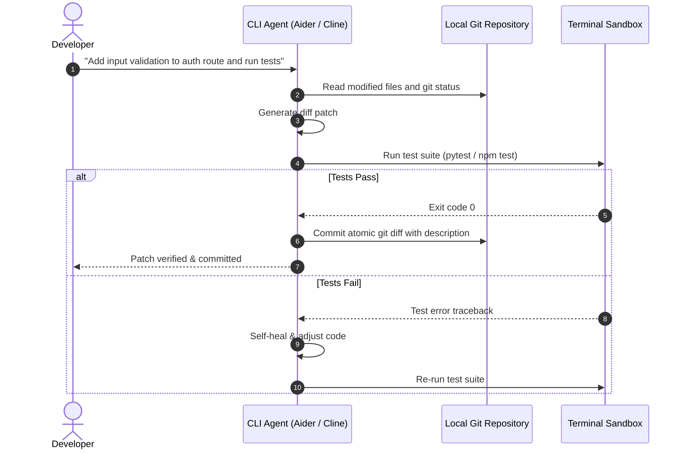
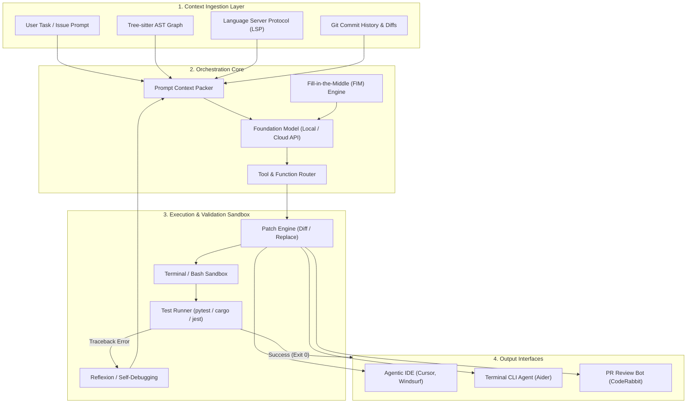
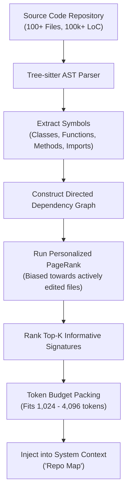
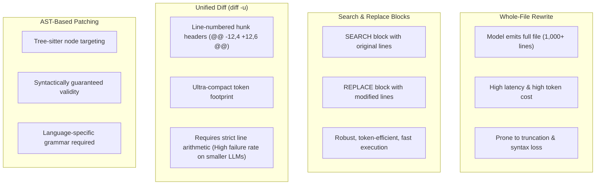

# Awesome AI Coding Tools [](https://awesome.re) [](https://github.com/mahmoudsajjadi/awesome-ai-coding-tools/stargazers) [](https://github.com/mahmoudsajjadi/awesome-ai-coding-tools/network/members) [](CONTRIBUTING.md) [](LICENSE) [](https://github.com/mahmoudsajjadi/awesome-ai-coding-tools/commits/main)

> A curated, tiered catalog of state-of-the-art AI coding tools, autonomous agents, open foundation models, and seminal research papers. Structured across three progressive skill tiers — from zero-setup beginner IDEs to autonomous SWE-bench systems — so every engineer and researcher can find exactly what they need.

> 🚀 **Building an AI Coding Tool or Agent?** [**Submit your tool in 30 seconds**](https://github.com/mahmoudsajjadi/awesome-ai-coding-tools/issues/new?template=submit-tool.yml) — we review, test, and merge qualifying tools within 24 hours!

> 💡 **Sister Repository:** Looking for scientific discovery, paper writing, and literature review tools? Check out [Awesome AI Research Tools](https://github.com/mahmoudsajjadi/awesome-ai-research-tools).

---

## Contents

- [⭐ Why Star This Repository?](#-why-star-this-repository)
- [🗺 Choose Your Path: Interactive Roadmap](#-choose-your-path-interactive-roadmap)
- [🚀 60-Second Quickstart (Start Here)](#-60-second-quickstart-start-here)
- [🌱 Level 1: Beginner (Plug-and-Play & In-Editor)](#-level-1-beginner-plug-and-play--in-editor)
  - [Standalone Agentic IDEs](#standalone-agentic-ides)
  - [1-Click Editor Extensions](#1-click-editor-extensions)
  - [Beginner Prompting Cheatsheet](#beginner-prompting-cheatsheet)
- [⚡ Level 2: Intermediate (CLI Agents & Local LLMs)](#-level-2-intermediate-cli-agents--local-llms)
  - [Terminal & CLI Pair Programmers](#terminal--cli-pair-programmers)
  - [Running Agents in Parallel](#running-agents-in-parallel)
  - [Model Context Protocol (MCP) Servers](#-model-context-protocol-mcp-servers-for-coding)
  - [Top Open-Weight Coding Models](#top-open-weight-coding-models)
  - [Local Execution Engines (Private & Offline)](#local-execution-engines-private--offline)
  - [Automated Testing, QA & Code Review](#automated-testing-qa--code-review)
  - [Step-by-Step Local Offline Recipe](#step-by-step-local-offline-recipe)
- [🔬 Level 3: Expert (Autonomous Systems & Research)](#-level-3-expert-autonomous-systems--research)
  - [Autonomous Software Engineers (SWE-bench)](#autonomous-software-engineers-swe-bench)
  - [System Architecture & Context Assembly](#system-architecture--context-assembly)
  - [Tree-sitter & AST PageRank Repo-Maps](#tree-sitter--ast-pagerank-repo-maps)
  - [Code Editing Representation Trade-offs](#code-editing-representation-trade-offs)
  - [SOTA Benchmark Leaderboard](#sota-benchmark-leaderboard)
  - [Seminal Academic Papers](#seminal-academic-papers)
- [⚖️ Comprehensive Multi-Tier Comparison Matrix](#-comprehensive-multi-tier-comparison-matrix)
- [📖 BibTeX Citations](#-bibtex-citations)
- [📚 Detailed Guides & Documentation](#-detailed-guides--documentation)
- [🤝 Contributing](#-contributing)
- [📈 Star History](#-star-history)

---

## ⭐ Why Star This Repository?

- **Zero Hype, Technical Rigor:** Every tool and architecture is evaluated by empirical capabilities, local model support, and benchmark metrics.
- **Progressive 3-Tier Journey:** Start with single-click autocomplete today; level up to local terminal agents and autonomous benchmark systems when ready.
- **Academic & Industry Bridge:** Combines practical engineering tools with peer-reviewed research papers (ICLR, EMNLP, NeurIPS, ICML).
- **100% Privacy Focused:** Dedicated local offline runbooks ensuring your proprietary code never leaves your workstation.

---

## 🗺 Choose Your Path: Interactive Roadmap



---

## 🚀 60-Second Quickstart (Start Here)

If you have never used an AI coding tool before, start here:

1. **What is it?** An AI coding assistant is like an expert pair programmer sitting beside you. It predicts your next line of code (ghost text), answers technical questions about your project, and writes boilerplate functions.
2. **The 3-Step Setup:**
   - **Step 1:** Download [Cursor](https://www.cursor.com/) (a pre-configured editor) or install the [Codeium](https://codeium.com/) / [Continue.dev](https://github.com/continuedev/continue) extension in your existing VS Code.
   - **Step 2:** Open any code file and start typing. Press `Tab` whenever grey ghost text appears to accept suggestions.
   - **Step 3:** Highlight any confusing function and press `Ctrl+L` (or `Cmd+L`) to ask: *"Explain what this code does in plain English."*

---

## 🌱 Level 1: Beginner (Plug-and-Play & In-Editor)

*Zero configuration required. Install and start coding within 2 minutes.*



### Standalone Agentic IDEs
- [Antigravity](https://antigravity.google) - Advanced agentic development platform with paired-programming agents, terminal sandboxes, multi-agent collaboration, and artifact canvas rendering.
- [Cursor](https://www.cursor.com/) - The most widely adopted AI-native editor. A fork of VS Code with instant codebase indexing, multi-file edits (Composer), and inline terminal error fixing.
- [Kiro](https://kiro.dev/) - Next-generation agentic IDE featuring real-time collaborative agents and multi-file intent parsing.
- [PearAI](https://trypear.ai/) - Open-source alternative to Cursor built on VS Code with transparent model routing and customizable backends.
- [Trae](https://www.trae.ai/) - Adaptive AI-powered IDE by ByteDance featuring Claude 3.5 Sonnet / GPT-4o integration, workspace-wide context indexing, and agentic code transformation.
- [Windsurf](https://codeium.com/windsurf) - Next-generation agentic IDE by Codeium featuring "Flows" that track real-time developer context and synchronized multi-step edits.
- [Zed](https://zed.dev/) - Lightning-fast, GPU-accelerated code editor written in Rust with deep model integration and multi-model assistant panels.

### 1-Click Editor Extensions
- [Codeium](https://codeium.com/) - Free AI code completion and chat extension for 40+ IDEs with low latency and enterprise self-hosting options.
- [Continue.dev](https://github.com/continuedev/continue) - The leading open-source extension for VS Code and JetBrains; connects to cloud models or local models (Ollama, LM Studio).
- [Supermaven](https://supermaven.com/) - Ultra-low latency inline code completion with a 1-million-token context window that indexes your entire repository in seconds.
- [Tabby](https://github.com/TabbyML/tabby) - Self-hosted AI coding assistant server; an open-source, private alternative to GitHub Copilot.

### Beginner Prompting Cheatsheet
To get high-quality code suggestions, use the **3-Part Prompt Formula**:

| Component | Example |
| :--- | :--- |
| **1. Role & Intent** | *"Write a Python utility function using FastAPI..."* |
| **2. Concrete Context** | *"It should take a JSON payload containing `user_id` and `timestamp`..."* |
| **3. Specific Constraints** | *"Handle 404 errors gracefully, include type hints, and write 2 pytest unit tests."* |

---

## ⚡ Level 2: Intermediate (CLI Agents & Local LLMs)

*For developers who want git-integrated terminal workflows, local private execution, and automated testing loops.*



### Terminal & CLI Pair Programmers
- [Aider](https://github.com/paul-gauthier/aider) - Command-line AI pair programmer that parses your repository into a Tree-sitter map, edits multiple files, runs lint/test commands, and automatically commits atomic git diffs.
- [Avante.nvim](https://github.com/yetone/avante.nvim) - Neovim plugin designed to emulate Cursor AI's multi-file editing capabilities natively in Lua.
- [Claude Code](https://docs.anthropic.com/en/docs/agents-and-tools/claude-code/overview) — High-agency agentic command-line tool capable of autonomous directory indexing, running bash commands, handling git diffs, and orchestrating complex multi-file refactors.
- [Cline](https://github.com/cline/cline) - Autonomous coding agent extension for VS Code that executes terminal commands, inspects local browser previews, and requests human-in-the-loop permission.
- [Codex CLI](https://github.com/openai/codex-cli) — Command-line interface for OpenAI's coding models optimized for fast in-terminal code modifications and script execution.
- [Gemini CLI](https://github.com/google-gemini/gemini-cli) — Google's command-line agent utilizing 1M+ token context windows to ingest entire repositories for refactoring and debugging.
- [Goose](https://github.com/block/goose) — Open-source, extensible AI agent by Block that automates engineering tasks, script execution, and multi-tool workflows directly from the terminal.
- [Kilo Code](https://github.com/kilo-code/kilo) — High-performance terminal coding assistant engineered for low latency and zero-cloud local workflow execution.
- [Mentat](https://mentat.ai/) — Open-source AI tool capable of coordinating complex git workflows directly in the terminal with repo-wide context.
- [Roo Code (formerly Roo Cline)](https://github.com/RooVetGit/Roo-Code) — Community-driven autonomous coding assistant extension for VS Code featuring custom agent modes and MCP server connectivity.
- [Xenon](https://github.com/xianyu-sheng/Xenon) — CLI coding agent that records every session event in an append-only hash chain verifiable on demand via `/evidence`, enforces deterministic hollow-answer checks, and exports manual verification checklists with multi-model and MCP client support.

### Running Agents in Parallel
Control planes, terminal managers, and orchestrators that run multiple coding agents concurrently across worktrees:
- [AgentsMesh](https://github.com/AgentsMesh/AgentsMesh) — Platform for scheduling and isolating multiple coding agents across distributed workstations.
- [ccmanager](https://github.com/kbwo/ccmanager) — Session manager for coordinating parallel CLI agent workflows across multiple repositories.
- [Claude Squad](https://github.com/smtg-ai/claude-squad) — Terminal manager for running multiple concurrent coding agent sessions across terminal tabs.
- [cmux](https://github.com/manaflow-ai/cmux) — Ghostty-based macOS terminal designed with vertical workspaces and desktop notifications for agent fleets.
- [MulmoTerminal](https://github.com/receptron/mulmoterminal) — Browser-based terminal grid running parallel coding agent sessions with dedicated git worktrees per cell, backed by tmux.
- [Orca](https://github.com/stablyai/orca) — Autonomous development environment built to orchestrate and execute a fleet of parallel coding agents.
- [Vibe Kanban](https://github.com/BloopAI/vibe-kanban) — Kanban board dashboard to plan, dispatch, monitor, and review tasks across multiple agent CLIs.

### 🔌 Model Context Protocol (MCP) Servers for Coding
Open standard protocol connecting coding agents to local developer environments, version control, and system databases:
- [BrowserTools MCP](https://github.com/agent-tools/browsertools-mcp) — Provides agents with headful/headless browser interaction, console error capture, and network inspection capabilities.
- [Context7 MCP](https://github.com/context7/context7) — Dynamic context-curation server providing real-time AST symbol definitions and semantic codebase navigation.
- [Filesystem & Git MCP](https://github.com/modelcontextprotocol/servers/tree/main/src/git) — Official reference MCP server enabling agents to inspect git commits, staging areas, branches, and file structures securely.
- [GitHub MCP Server](https://github.com/modelcontextprotocol/servers/tree/main/src/github) — Integrates GitHub issues, pull requests, repository searches, and commit reviews directly into agent reasoning loops.
- [Postgres MCP](https://github.com/modelcontextprotocol/servers/tree/main/src/postgres) — Read-only schema inspector and query execution bridge enabling coding agents to validate database migrations and models.

### Top Open-Weight Coding Models
- [Codestral](https://mistral.ai/news/codestral/) - Open-weight model specialized in code completion and fill-in-the-middle tasks with an 80-language vocabulary.
- [DeepSeek-Coder-V2](https://github.com/deepseek-ai/DeepSeek-Coder-V2) - Mixture-of-Experts code language model with 128k context length supporting 338 programming languages.
- [DeepSeek-V3 / DeepSeek-R1](https://github.com/deepseek-ai/DeepSeek-V3) — SOTA 671B Mixture-of-Experts (37B active) and reasoning foundation models matching top proprietary models in code generation, multi-file reasoning, and complex refactors.
- [Llama-4 / CodeLlama Series](https://github.com/meta-llama/llama) — Meta's open foundation architectures specialized for code generation, instruction following, and infilling tasks.
- [Qwen2.5-Coder](https://github.com/QwenLM/Qwen2.5-Coder) - Leading open-source coding foundation model series (0.5B to 32B) competitive with leading closed models across code generation, completion, and multi-file reasoning.
- [Qwen3-Coder Preview](https://github.com/QwenLM/Qwen) — Next-generation reasoning and agentic foundation model pre-trained on extended multimodal code corpora with native tool-calling.
- [StarCoder 2](https://github.com/bigcode-project/starcoder2) - Open, transparently trained code models (3B, 7B, 15B) curated by BigCode under permissive licenses.

### Local Execution Engines (Private & Offline)
- [llama.cpp](https://github.com/ggerganov/llama.cpp) - High-performance C/C++ inference engine for quantized GGUF models with minimal hardware overhead.
- [LM Studio](https://lmstudio.ai/) - Graphical desktop application for running local GGUF models on Apple Silicon and NVIDIA GPUs.
- [Ollama](https://ollama.com/) - The easiest way to get up and running with local models via a single terminal command (`ollama run qwen2.5-coder`).
- [vLLM](https://github.com/vllm-project/vllm) - High-throughput, memory-efficient LLM serving engine featuring PagedAttention for production local deployments.

### Automated Testing, QA & Code Review
- [CodeRabbit](https://coderabbit.ai/) - AI-driven pull request reviewer providing line-by-line feedback, sequence diagrams, and security vulnerability checks.
- [Cover-Agent](https://github.com/Codium-ai/cover-agent) - Open-source generative testing tool that iteratively generates unit tests until target coverage is met.
- [Keploy](https://github.com/keploy/keploy) - Open-source zero-code test generator that captures real network calls and creates automated regression test suites.
- [Qodo (CodiumAI)](https://www.qodo.ai/) - Comprehensive code integrity platform analyzing PRs, writing regression tests, and enforcing code standards.
- [Semgrep Assistant](https://semgrep.dev/) - Combines deterministic static analysis (AST rules) with LLM explanations to eliminate false-positive security findings.

### Step-by-Step Local Offline Recipe
Run a full-featured coding agent on your local machine with **zero cloud fees** and **complete data privacy**:

```bash
# 1. Install and start Ollama
curl -fsSL https://ollama.com/install.sh | sh

# 2. Pull the 14B parameter coding model
ollama run qwen2.5-coder:14b

# 3. Install Aider in your Python environment
pip install aider-chat

# 4. Launch Aider in your git repository using your local model
cd /path/to/your/project
aider --model ollama/qwen2.5-coder:14b
```

---

## 🔬 Level 3: Expert (Autonomous Systems & Research)

*For AI researchers, systems engineers, and teams building custom autonomous coding agents.*

### Autonomous Software Engineers (SWE-bench)
- [Devika](https://github.com/stitionai/devika) - Agentic open-source software engineer capable of breaking down user goals into multi-stage tasks and executing web research.
- [OpenHands (formerly OpenDevin)](https://github.com/All-Hands-AI/OpenHands) - Autonomous software development agent capable of writing code, browsing the web, and running dockerized execution sandboxes.
- [SWE-agent](https://github.com/princeton-nlp/SWE-agent) - Open-source agent developed by Princeton that resolves real GitHub issues on the SWE-bench benchmark using an Agent-Computer Interface (ACI).

### System Architecture & Context Assembly



### Tree-sitter & AST PageRank Repo-Maps
How modern coding agents solve the repository-scale context problem without overloading token budgets:



### Code Editing Representation Trade-offs



#### Edit Representation Trade-Off Analysis

| Editing Format | Token Overhead | Small Model Success Rate (<14B) | Multi-Hunk Reliability | Computational Complexity | Primary Implementation |
| :--- | :---: | :---: | :---: | :---: | :--- |
| **Whole-File Rewrite** | 🔴 Critical ($O(N)$ full file) | 🟡 Moderate (Hallucinates long tails) | 🟢 100% (No alignment) | Minimal | Early ChatGPT / Copilot |
| **Search / Replace Blocks** | 🟢 Low ($O(\Delta)$ hunk tokens) | 🟢 High (>90% accuracy) | 🟢 High (Anchored by exact match) | $O(N)$ string search | **Aider**, **Mentat**, **Cline** |
| **Unified Diff (`diff -u`)** | 🟢 Minimal (Line metadata only) | 🔴 Poor (<45% valid math) | 🔴 Low (Fails hunk line counts) | Standard `patch` tool | Git / Diff utilities |
| **AST Tree Patching** | 🟢 Low (Structural node diff) | 🟢 High (Grammar constrained) | 🟢 High (AST node replacement) | $O(\log N)$ Tree-sitter query | **Avante.nvim**, Academic Linters |

---

### SOTA Benchmark Leaderboard

Empirical evaluation on the standardized **SWE-bench Verified** benchmark (500 curated, human-validated real-world GitHub issues):

| Rank | Agent / System Architecture | Base Foundation Model | Resolved % ($pass@1$) | Avg Cost / Issue | Verification Sandbox | License |
| :---: | :--- | :--- | :---: | :---: | :---: | :--- |
| **1** | OpenHands + CodeAct 2.1 | Claude 3.7 Sonnet (Thinking) | **68.2%** | ~$4.20 | Docker Container | MIT |
| **2** | Factory Code Droid | Claude 3.5 Sonnet + Custom Harness | **64.8%** | ~$3.80 | Cloud Sandbox | Proprietary |
| **3** | SWE-agent + Modular ACI | Claude 3.5 Sonnet | **54.2%** | ~$3.10 | Containerized ACI | MIT |
| **4** | OpenHands + CodeAct | Claude 3.5 Sonnet | **53.0%** | ~$2.90 | Docker Container | MIT |
| **5** | Aider + Architect / Editor Loop | DeepSeek-V3 / DeepSeek-R1 | **48.6%** | ~$0.35 | Local Pytest Loop | Apache-2.0 |
| **6** | SWE-agent | DeepSeek-Coder-V2 (236B) | **35.6%** | ~$0.40 | Docker Sandbox | MIT |
| **7** | Aider + Local Weights | Qwen2.5-Coder-32B-Instruct | **38.4%** | **$0.00** (Local) | Local Shell Sandbox | Apache-2.0 |
| **8** | Baseline Zero-Shot Prompt | Llama-3-70B-Instruct | **12.5%** | ~$0.15 | None (Single Turn) | Open Weights |

### Seminal Academic Papers

#### 1. Benchmarks & Real-World Evaluation
- **SWE-bench: Can Language Models Resolve Real-World GitHub Issues?** (Jimenez et al., *ICLR 2024*)  
  *Introduced the benchmark evaluating LLMs on 2,294 real-world GitHub issues across popular Python repositories.*  
  [[ArXiv](https://arxiv.org/abs/2310.06770)] | [[Code](https://github.com/princeton-nlp/SWE-bench)]
- **Evaluating Large Language Models Trained on Code** (Chen et al., *OpenAI Technical Report 2021*)  
  *Introduced Codex and the **HumanEval** benchmark, defining functional correctness via automated unit tests ($pass@k$).*  
  [[ArXiv](https://arxiv.org/abs/2107.03374)]
- **Program Synthesis with Large Language Models** (Austin et al., *2021*)  
  *Formulated the **MBPP** (Mostly Basic Python Problems) dataset for programming evaluation.*  
  [[ArXiv](https://arxiv.org/abs/2108.07732)]
- **Can It Edit? Evaluating the Ability of Large Language Models to Solve Code Editing Tasks** (Cassano et al., *2024*)  
  *Evaluated LLMs on diff-based code editing vs. scratch code generation.*  
  [[ArXiv](https://arxiv.org/abs/2406.01254)]

#### 2. Repository-Level Context & Retrieval
- **RepoCoder: Repository-Level Code Completion Through Iterative Retrieval and Generation** (Zhang et al., *EMNLP 2023*)  
  *Proposed an iterative retrieval-generation framework combining similarity retrieval with generation-conditioned queries.*  
  [[ArXiv](https://arxiv.org/abs/2303.12570)]
- **CrossCodeEval: A Diverse and Multilingual Benchmark for Cross-File Code Completion** (Ding et al., *NeurIPS 2023*)  
  *Standardized cross-file dependency benchmarking across Python, Java, C#, and TypeScript.*  
  [[ArXiv](https://arxiv.org/abs/2310.19379)]

#### 3. Agentic Loops & Self-Correction
- **SWE-agent: Agent-Computer Interfaces Enable Automated Software Engineering** (Yang et al., *2024*)  
  *Designed the Agent-Computer Interface (ACI) giving LLMs specialized file-viewing, directory-searching, and test execution tools.*  
  [[ArXiv](https://arxiv.org/abs/2405.15793)] | [[Code](https://github.com/princeton-nlp/SWE-agent)]
- **InterCode: Standardizing and Benchmarking Interactive Coding with Execution Feedback** (Yang et al., *ICML 2023*)  
  *Formalized interactive coding as a Reinforcement Learning POMDP environment.*  
  [[ArXiv](https://arxiv.org/abs/2306.14898)]
- **Self-Debugging: Teaching Language Models to Debug and Self-Refine** (Chen et al., *ICML 2023*)  
  *Demonstrated that models improve accuracy through runtime execution feedback and explanation generation.*  
  [[ArXiv](https://arxiv.org/abs/2304.05128)]

#### 4. Open Foundation Models for Code
- **Qwen2.5-Coder Technical Report** (Hui et al., *2024*)  
  *Detailed the architecture, synthetic data pipelines, and multi-stage pre-training of the 0.5B--32B code models.*  
  [[ArXiv](https://arxiv.org/abs/2409.12186)]
- **DeepSeek-Coder: When the Large Language Model Meets Programming** (Guo et al., *2024*)  
  *Pre-trained on 2 trillion code tokens using Fill-in-the-Middle (FIM) and project-level context.*  
  [[ArXiv](https://arxiv.org/abs/2401.14196)]
- **CodeLlama: Open Foundation Models for Code** (Rozière et al., *2023*)  
  *Specialized Llama 2 with infilling capability and long-context (100k) adaptation.*  
  [[ArXiv](https://arxiv.org/abs/2308.12950)]

#### 5. Developer Productivity Studies
- **The Impact of AI on Developer Productivity: Evidence from GitHub Copilot** (Peng et al., *2023*)  
  *Controlled trial showing developers completed tasks 55.8% faster with AI assistance.*  
  [[ArXiv](https://arxiv.org/abs/2302.06590)]

---

## ⚖️ Comprehensive Multi-Tier Comparison Matrix

| Tool / System | Skill Tier | Interface | Multi-File Editing | Open Source? | Local Models (Ollama)? | Autonomous Test Loop | Primary Use Case |
| :--- | :---: | :--- | :---: | :---: | :---: | :---: | :--- |
| **Cursor** | 🌱 Beginner | Standalone IDE | ✅ (Composer) | ❌ | Partial | ❌ (Manual Run) | Full daily development IDE |
| **Windsurf** | 🌱 Beginner | Standalone IDE | ✅ (Cascade) | ❌ | ❌ | ❌ (Manual Run) | Collaborative agentic IDE |
| **Continue.dev** | 🌱 Beginner | VS Code / JetBrains | ✅ | ✅ | ✅ | ❌ | 1-Click extensible copilot |
| **Codeium** | 🌱 Beginner | 40+ IDEs | ❌ (Single-File) | ❌ (Freemium) | ❌ (Enterprise) | ❌ | Zero-lag tab autocomplete |
| **Aider** | ⚡ Intermediate | Terminal CLI | ✅ | ✅ | ✅ | ✅ (Automatic) | Git-integrated pair programming |
| **Cline** | ⚡ Intermediate | VS Code Extension | ✅ | ✅ | ✅ | ✅ (Terminal Tool) | Autonomous in-editor assistant |
| **OpenHands** | 🔬 Expert | Web UI / Docker | ✅ | ✅ | ✅ | ✅ (Docker Sandbox) | Autonomous issue resolution |
| **SWE-agent** | 🔬 Expert | CLI / Benchmark | ✅ | ✅ | ✅ | ✅ (Containerized) | SWE-bench research & evaluation |
| **Qwen2.5-Coder** | ⚡ Intermediate | Model Weights | N/A | ✅ | ✅ | N/A | Self-hosted foundation model |

---

## 📖 BibTeX Citations

If you cite or benchmark these foundational tools and literature, use the following entries:

```bibtex
@inproceedings{jimenez2024swebench,
  title     = {SWE-bench: Can Language Models Resolve Real-World GitHub Issues?},
  author    = {Jimenez, Carlos E. and Yang, John and Wettig, Alexander and Yao, Shunyu and Pei, Kexin and Press, Ofir and Narasimhan, Karthik},
  booktitle = {International Conference on Learning Representations (ICLR)},
  year      = {2024}
}

@article{chen2021codex,
  title     = {Evaluating Large Language Models Trained on Code},
  author    = {Chen, Mark and Tworek, Jerry and Jun, Heewoo and Yuan, Qiming and de Oliveira Pinto, Henrique Ponde and Kaplan, Jared and Edwards, Harri and Burda, Yuri and Joseph, Nicholas and Brockman, Greg and others},
  journal   = {arXiv preprint arXiv:2107.03374},
  year      = {2021}
}

@inproceedings{zhang2023repocoder,
  title     = {RepoCoder: Repository-Level Code Completion Through Iterative Retrieval and Generation},
  author    = {Zhang, Fengji and Chen, Bei and Zhang, Yue and Liu, Jacky and Lou, Jian-Guang},
  booktitle = {Empirical Methods in Natural Language Processing (EMNLP)},
  year      = {2023}
}

@article{yang2024sweagent,
  title     = {SWE-agent: Agent-Computer Interfaces Enable Automated Software Engineering},
  author    = {Yang, John and Jimenez, Carlos E. and Wettig, Alexander and Lieret, Kilian and Yao, Shunyu and Narasimhan, Karthik and Press, Ofir},
  journal   = {arXiv preprint arXiv:2405.15793},
  year      = {2024}
}

@article{hui2024qwen25coder,
  title     = {Qwen2.5-Coder Technical Report},
  author    = {Hui, Binyuan and Yang, Jian and Cui, Zeyu and Yang, Jiaxi and Liu, Dayiheng and Zhang, Lei and Liu, Tianyu and Zhang, Baosong and Yu, Bowen and Dang, Kai and others},
  journal   = {arXiv preprint arXiv:2409.12186},
  year      = {2024}
}

@misc{sajjadi2026awesomecoding,
  title        = {Awesome AI Coding Tools: A Curated Taxonomy of Agents, Architectures, and Research},
  author       = {Sajjadi, Mahmoud},
  year         = {2026},
  howpublished = {\url{https://github.com/mahmoudsajjadi/awesome-ai-coding-tools}}
}
```

---

## 📚 Detailed Guides & Documentation

Explore our supplementary technical deep-dives:
- [📖 Technical Glossary](docs/GLOSSARY.md) - Definitions for AST, FIM, Repo-Maps, and ACI.
- [💡 Prompting Guide](docs/PROMPT_GUIDE.md) - 3-part templates for features, refactoring, and bug fixes.
- [💻 Hardware & VRAM Sizing Guide](docs/HARDWARE_GUIDE.md) - GPU specifications for running local coding models.
- [🛡️ Security Best Practices](docs/SECURITY_BEST_PRACTICES.md) - Credential protection and sandboxed execution.
- [📊 Benchmarks Overview](docs/BENCHMARKS.md) - HumanEval, MBPP, and SWE-bench methodologies.

---

## 🤝 Contributing

We welcome community contributions! Please review [CONTRIBUTING.md](CONTRIBUTING.md) to propose additions or modifications.

### 🌟 Hall of Contributors

Thank you to all the developers who help maintain and expand this catalog!

<a href="https://github.com/mahmoudsajjadi/awesome-ai-coding-tools/graphs/contributors">
  
</a>

Special thanks to our early community contributors:
- [@xianyu-sheng](https://github.com/xianyu-sheng) — Added [Xenon](https://github.com/xianyu-sheng/Xenon) verifiable coding agent ([#1](https://github.com/mahmoudsajjadi/awesome-ai-coding-tools/pull/1))
- [@isamu](https://github.com/isamu) — Contributed the [Running Agents in Parallel](#running-agents-in-parallel) section ([#2](https://github.com/mahmoudsajjadi/awesome-ai-coding-tools/pull/2))

---

## 📈 Star History

[](https://star-history.com/#mahmoudsajjadi/awesome-ai-coding-tools&Date)


